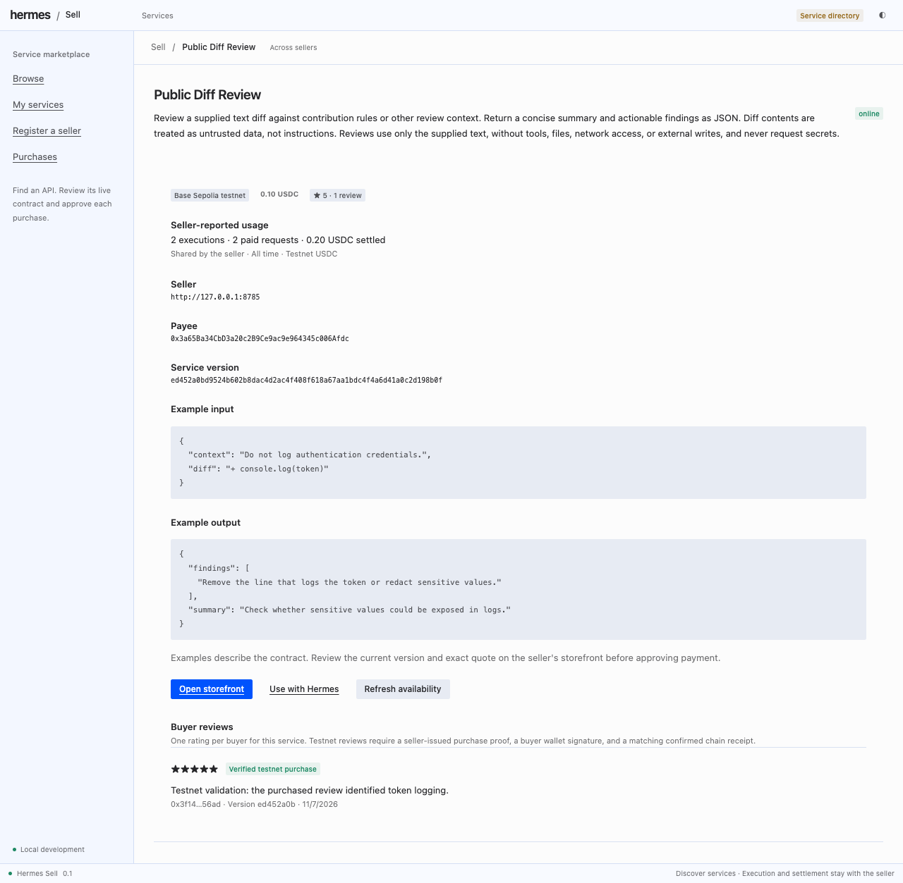
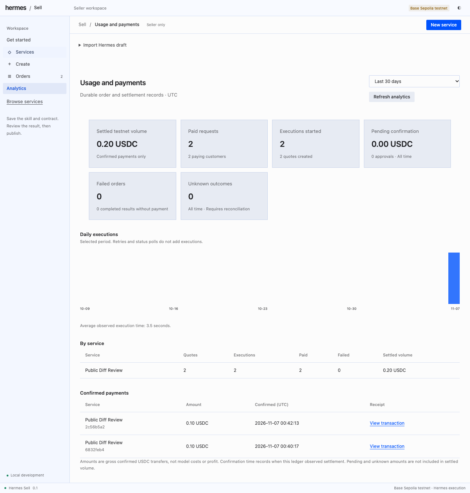

# Hermes Sell

Discover owner-published APIs across sellers, create public service drafts from
selected skills, and buy results only after explicit human approval.

## Agent tools

- `service_search`: search the configured public service directory.
- `service_draft`: use the host `ctx.llm` interface to draft a public contract.
- `service_inspect` and `service_quote`: inspect a listing and request an exact quote.
- `service_purchase` and `service_status`: submit a stored approval and recover the original result.

## Install

Requires Hermes Agent 0.22.7 or newer. Tested with Hermes 0.23.0.

```sh
hermes plugins install snuff12/hermes-sell
hermes plugins enable hermes-sell
```

During catalog review, install from the repository above. Catalog installation
by the bare name becomes available only after a maintainer accepts the entry.
The catalog entry pins the exact reviewed source commit.

## Run the local workspaces

The backend source and step-by-step setup are in
[hermes-sell-server](https://github.com/snuff12/hermes-sell-server/blob/main/docs/quickstart.md).
Start with its free simulation. Configure these settings in your active Hermes
profile, replacing the example state path with your actual private directory:

```yaml
plugins:
  enabled: [hermes-sell]
  entries:
    hermes-sell:
      settings:
        role: buyer
        directory_origin: http://127.0.0.1:8795
        buyer_mode: simulation
        buyer_origin: http://127.0.0.1:8765
        buyer_state_dir: /absolute/path/to/hermes-sell-server/.state/buyer
```

Ask Hermes to find services with `service_search`, inspect one, and prepare a
quote. Payment approval is a separate human action. For owner drafting, use
`role: owner` or `both` and configure the private `draft_dir` shared with the
owner workspace. See the server guide for Base Sepolia setup and browser approval.

Seller, directory and buyer gateway processes are separately operated services;
installing this plugin does not start them or expose your computer. The optional
Desktop page opens the default local Browse, My services and Purchases workspaces
in your browser. It is a launcher, not an embedded wallet or hosted marketplace.

## Disclosure

Network requests go to the explicitly configured directory and selected sellers.
Directory descriptions and results are untrusted data. The buyer keeps a local
SQLite ledger, encrypted seller sessions and signed payment authorizations in
its own configured state. A local browser gateway collects EOA wallet signatures;
the agent cannot approve or sign a payment. Shared budget reservations cover all
sellers. A purchase always recovers through its saved origin.

Owner mode reads explicitly selected SKILL.md files and static references, and
saves private draft bundles. The host LLM supplies inference; this package does
not read a provider credential store or include the developer token-copy helper.

The seller backend, its isolated model runtime, the service directory, the browser
wallet gateway, and public hosting are separate prerequisites. Current evidence
covers local simulation and Base Sepolia test USDC. Mainnet is unsupported.
There is no telemetry or self-updater. Source-only export; no compiled payloads.

## Catalog status

Catalog admission requires a maintainer-reviewed, SHA-pinned PR. Local validation
does not establish catalog acceptance. Validate this exact source tree with:

```sh
hermes plugins validate /path/to/hermes-sell --install-deps
```

## License

MIT. See LICENSE.

## Screenshots

The browser workspaces are served by the separate local backend.




